# Part 2 — Page Navigation Flow (Mermaid State Diagram)

All pages as states, all user interactions as transitions.

```mermaid
stateDiagram-v2

    [*] --> Welcome

    Welcome --> Onboarding : First sign in
    Welcome --> Dashboard : Returning sign in
    Welcome --> Dashboard : Firebase sign in error

    Onboarding --> OnboardingStep2 : Next
    OnboardingStep2 --> OnboardingStep3 : Next
    OnboardingStep3 --> Dashboard : Complete
    Onboarding --> Welcome : Back

    Dashboard --> SessionComposer : New Task
    Dashboard --> SessionList : Sessions
    Dashboard --> History : History
    Dashboard --> Settings : Settings
    Dashboard --> SurfaceOverlay : Claude pushes surface
    Dashboard --> SurfaceOverlay : Help palette action

    SurfaceOverlay --> Dashboard : Surface dismissed
    SurfaceOverlay --> Dashboard : Surface submitted

    SurfaceOverlay --> BrowserSurface : Browser surface
    SurfaceOverlay --> CanvasSurface : Canvas surface
    SurfaceOverlay --> ImageSurface : Image surface
    SurfaceOverlay --> ScreenCaptureSurface : Screen capture
    SurfaceOverlay --> CodeDiffSurface : Code diff
    SurfaceOverlay --> ProcessManager : Process list
    SurfaceOverlay --> TerminalSurface : Terminal output

    BrowserSurface --> SurfaceOverlay : User closes or submits
    CanvasSurface --> SurfaceOverlay : User submits drawing
    ImageSurface --> SurfaceOverlay : User annotates and submits
    ScreenCaptureSurface --> SurfaceOverlay : User captures and sends
    CodeDiffSurface --> SurfaceOverlay : User approves or requests changes
    ProcessManager --> SurfaceOverlay : User closes process view
    TerminalSurface --> SurfaceOverlay : User sends output or closes

    SessionComposer --> Dashboard : Task sent
    SessionComposer --> Dashboard : Cancel
    SessionComposer --> Dashboard : Empty submit error

    SessionList --> Dashboard : Back
    SessionList --> SessionDetail : Select session
    SessionList --> SessionComposer : New Task
    SessionList --> SessionList : Search
    SessionList --> SessionList : Rename
    SessionList --> SessionList : Archive
    SessionList --> SessionList : Delete

    SessionDetail --> SessionList : Back
    SessionDetail --> SurfaceOverlay : Resume surface
    SessionDetail --> SessionDetail : Duplicate
    SessionDetail --> SessionDetail : Archive
    SessionDetail --> SessionDetail : Delete
    SessionDetail --> Dashboard : New Task

    History --> Dashboard : Back
    History --> SessionDetail : Select past session
    History --> History : Search
    History --> History : Filter
    History --> SessionDetail : Duplicate
    History --> History : Clear completed

    Settings --> Dashboard : Save and back
    Settings --> Settings : Switch section
    Settings --> Welcome : Sign out
    Settings --> Settings : Change workspace path

    Dashboard --> ConnectionError : Backend disconnect
    ConnectionError --> Dashboard : Reconnect
    ConnectionError --> Welcome : Sign out

    Dashboard --> OfflineBanner : Internet disconnect
    OfflineBanner --> Dashboard : Reconnect

    Welcome --> ConnectionError : Backend unreachable
    Welcome --> Welcome : Firebase auth timeout

    Dashboard --> BackgroundSurfaceNotification : Surface while app inactive
    BackgroundSurfaceNotification --> SurfaceOverlay : Click notification
    BackgroundSurfaceNotification --> Dashboard : Dismiss notification

    Dashboard --> [*] : Quit application
    Settings --> [*] : Sign out and quit
```

## Navigation Rules

1. **Sidebar is persistent** — always visible on the left, even during SurfaceOverlay
2. **SurfaceOverlay is modal** — it sits on top of the current view, not a new page
3. **Back button** — Escape key always returns to the previous navigation state
4. **Surface stays with its session** — if you navigate away from a session,
   surfaces from that session are stored but not rendered
5. **Active surfaces persist** — if user minimizes the app during a surface,
   the surface remains in the session and can be resumed on return
