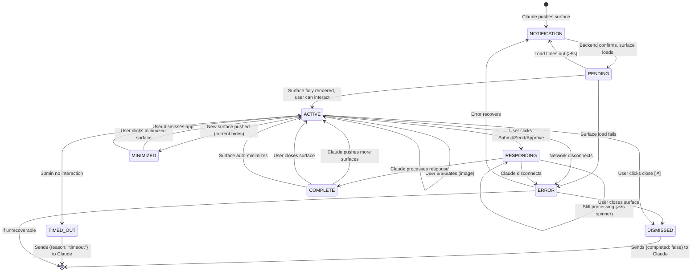

# Surface Transition Rules — Visual Spec

## Overview

This document provides a visual state transition diagram that complements `pre-surface-lifecycle-states.md`. Where the lifecycle states document describes each state, this document shows the transitions between them.

## State Transition Diagram

## Transition Rules

### NOTIFICATION → PENDING
| Requirement | Detail |
|-------------|--------|
| Trigger | Backend confirms surface data exists |
| Duration | <200ms (instant if data is cached) |
| Fallback | If >5s, show "Preparing surface..." toast |

### PENDING → ACTIVE
| Requirement | Detail |
|-------------|--------|
| Trigger | All surface content loaded (HTML, styles, images) |
| Duration | Depends on surface type: Browser ~2s, Canvas ~100ms, Diff ~500ms |
| Validation | If any resource fails to load, go to ERROR |

### ACTIVE → RESPONDING (Submit actions)
| Surface | Action that triggers |
|---------|---------------------|
| Browser | User types feedback + clicks Submit |
| Canvas | User clicks Send |
| Image | User clicks Send |
| ScreenCapture | User clicks Send |
| CodeDiff | User clicks Approve or Request Changes |
| ProcessManager | User clicks Stop (immediate, no Responding) |
| Terminal | User clicks Send to Claude |

**Critical:** ProcessManager and TerminalSurface skip RESPONDING entirely — they go ACTIVE → COMPLETE immediately. This is an exception documented in both the lifecycle states and surface lifecycle states docs, but the transition diagram above does not explicitly show this. The "ACTIVE → COMPLETE" path (bypassing RESPONDING) should be noted in implementation.

### ACTIVE → ACTIVE (navigation, not submit)
These transitions are special — the surface stays in the Active state, does NOT go to Responding:
- Browser: clicking links, typing URL, scrolling
- Canvas: drawing, erasing, undo/redo
- Image: zooming, panning, annotating
- Terminal: scrolling, searching, copying
- CodeDiff: scrolling, commenting (commenting does NOT trigger submit — only Approve/Request Changes does)

### ACTIVE → MINIMIZED
| Requirement | Detail |
|-------------|--------|
| Trigger | Claude pushes a new surface while one is active |
| Behavior | Current surface is minimized to bottom bar; new surface opens in main area |
| State preservation | All minimized surfaces keep their state; no data is lost |

### TIMED_OUT → [*]
| Requirement | Detail |
|-------------|--------|
| Trigger | 30 minutes of no user interaction in Active state |
| Timeout start | Only counts when surface is Active; not during Responding or Complete |
| Timeout reset | Any user interaction (click, scroll, type) resets the 30min timer |
| Exception | Browser navigation is always Active — clicking links does NOT count as interaction for timeout |

**Clarification needed:** The reviewed `05-screen-sequence-surfaces.md` and the unreviewed `pre-surface-lifecycle-states.md` both say BrowserSurface navigation is always Active. But the timeout rule says "no user interaction for 30 minutes." These conflict — does clicking links in a BrowserSurface reset the timeout? **Recommendation:** No, browser navigation should NOT reset the timeout. The 30min timer starts when the surface becomes Active and only resets by explicit user interaction (Submit, Send, Approve, Request Changes). Clicking links, scrolling, and navigating are passive actions.

## Error Recovery Paths

| Error | Can recover? | Recovery action |
|-------|-------------|-----------------|
| Surface load fails | Yes | Retry fetch from backend (up to 3 times) |
| Network disconnects | Yes | Queue actions locally, show banner |
| Claude disconnects | Partial | Surface stays open, user can close it |
| Firebase auth expires | Yes | Silent re-auth, resume operations |
| Firestore write fails | Yes | Queue action, retry on reconnect |
| Max surfaces reached | No | Block new surface, show toast |
| App crash | Partial | Restore last known state on restart |

## State Persistence

| State | Where persisted | Lifetime |
|-------|----------------|----------|
| Surface data | Firestore | Permanent (session lifetime) |
| Surface state (Active/Complete/Dismissed) | Firestore | Permanent |
| User response (draft) | IndexedDB | Until sent or app cleared |
| Minimized surfaces | Electron app state | Until app quit |
| Surface interactions | Firestore (append-only) | Permanent |
